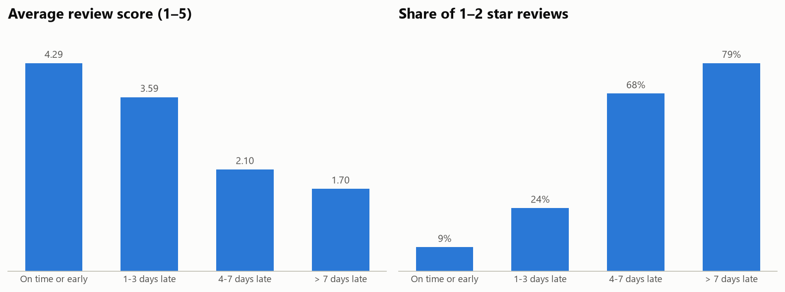
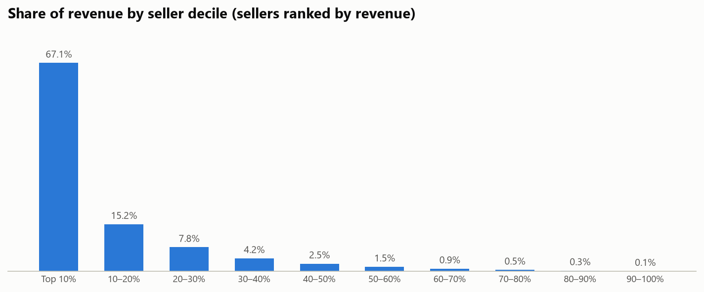

# E-commerce SQL Analysis — Olist Marketplace

Business analysis of ~100k real orders from [Olist](https://www.kaggle.com/datasets/olistbr/brazilian-ecommerce), a Brazilian e-commerce marketplace (2016–2018), answered entirely in SQL.

The goal is to answer the questions a commercial or operations team would actually ask: where the revenue comes from, whether customers come back, and what is hurting customer satisfaction.

## Key findings

Based on 96k delivered orders and R$ 13.2M in revenue (item prices, excluding freight). Full results are in [`output/`](output/), and all charts are in the [analysis notebook](notebooks/analysis.ipynb).





1. **Almost nobody comes back.** 97% of customers bought exactly once, and they account for 94.5% of revenue. In every monthly cohort, under 1% of customers return in any given later month. Growth depends almost entirely on acquiring new customers. ([Q3](sql/03_cohort_retention.sql), [Q5](sql/05_repeat_purchase.sql))
2. **Late delivery destroys satisfaction.** Orders delivered on time average 4.29 stars, with 9% bad reviews (1–2 stars). Orders more than 7 days late average 1.70 stars, with 79% bad reviews. Only 8% of orders arrive late, but the damage starts to show after 3 days of delay. ([Q7](sql/07_late_delivery_vs_reviews.sql))
3. **Revenue is concentrated in a few sellers.** The top 10% of sellers (297 of 2,970) generate 67% of revenue; the bottom half generates 3%. ([Q9](sql/09_seller_concentration.sql))
4. **Seven categories make half the revenue.** Of 74 categories, the top 7 account for 50%, led by health & beauty (9.3%) and watches & gifts (8.8%). ([Q2](sql/02_category_pareto.sql))
5. **Installments go with bigger baskets.** Credit card orders paid in 7+ installments are 12% of orders but 25.5% of payment value: R$ 334 on average, against R$ 101 for single-payment card orders. ([Q8](sql/08_payment_methods.sql))
6. **The Northeast gets the worst delivery.** Alagoas has 24% of orders late and a 24.5-day average delivery; Maranhão 20%. São Paulo alone is 38% of revenue, and the top 3 states 63%. ([Q6](sql/06_delivery_by_state.sql), [Q12](sql/12_state_revenue.sql))
7. **Office furniture is the problem category.** It has the lowest review score of any sizeable category (3.64, with 22% bad reviews), and freight costs 25% of the item price. ([Q11](sql/11_category_satisfaction.sql))

## Recommendations

1. **Invest in the second purchase.** With a 3% repeat rate, even a small lift is material: repeat customers spend R$ 245–426 over their lifetime against R$ 138 for one-time buyers. The 13.8k "at risk, high value" customers (29% of revenue, about 395 days since their last order) are the natural first target for a win-back campaign. ([Q4](sql/04_rfm_segmentation.sql))
2. **Treat delays over 3 days as a priority.** Set more realistic delivery estimates for Northeast states and warn customers proactively when an order is running late, since the review penalty rises sharply after day 3.
3. **Protect the top sellers.** With 67% of revenue in 297 sellers, losing a handful is a real risk. A key-account programme for the top decile, and growth support for deciles 2–3, would reduce that dependency.

These are correlations in historical data, not tested interventions: each recommendation should be validated with an experiment before a full rollout.

## Business questions

| # | Question | SQL techniques | Query |
|---|----------|----------------|-------|
| 1 | How are revenue, orders and average order value evolving? | `LAG`, running totals | [01_monthly_revenue.sql](sql/01_monthly_revenue.sql) |
| 2 | Which categories drive revenue (Pareto)? | 4-table join, cumulative share | [02_category_pareto.sql](sql/02_category_pareto.sql) |
| 3 | Do customers come back? Cohort retention | CTEs, date arithmetic, `FILTER` | [03_cohort_retention.sql](sql/03_cohort_retention.sql) |
| 4 | Who are the most valuable customers? RFM segments | `NTILE`, `CASE` segmentation | [04_rfm_segmentation.sql](sql/04_rfm_segmentation.sql) |
| 5 | How much revenue comes from repeat customers? | Bucketing, share of total | [05_repeat_purchase.sql](sql/05_repeat_purchase.sql) |
| 6 | Where is delivery slow or late? | Conditional aggregation, `HAVING` | [06_delivery_by_state.sql](sql/06_delivery_by_state.sql) |
| 7 | Does late delivery hurt review scores? | `ROW_NUMBER` de-duplication | [07_late_delivery_vs_reviews.sql](sql/07_late_delivery_vs_reviews.sql) |
| 8 | How do customers pay? Do installments mean bigger baskets? | `arg_max`, bucketing | [08_payment_methods.sql](sql/08_payment_methods.sql) |
| 9 | How dependent is the marketplace on top sellers? | Deciles, cumulative windows | [09_seller_concentration.sql](sql/09_seller_concentration.sql) |
| 10 | When do customers buy? | Date parts, `PARTITION BY` | [10_orders_by_weekday_hour.sql](sql/10_orders_by_weekday_hour.sql) |
| 11 | Which categories have high revenue but poor satisfaction? | Multiple CTEs, 5-table join | [11_category_satisfaction.sql](sql/11_category_satisfaction.sql) |
| 12 | Where is the revenue geographically? | Ranking, cumulative share | [12_state_revenue.sql](sql/12_state_revenue.sql) |

## Data model

```
customers ──< orders ──< order_items >── products >── category_translation
                 │            └──────>── sellers
                 ├──< order_payments
                 └──< order_reviews
```

Two shared views ([00_views.sql](sql/00_views.sql)) define the metrics once:

- `v_delivered_orders` — delivered orders joined to the real customer key (`customer_unique_id`; `customer_id` in the raw data is unique per order).
- `v_order_revenue` — one row per delivered order with revenue, freight and item count.

**Revenue** is the sum of item prices on delivered orders (GMV, excluding freight).

## How to run

Requires Python 3.10+.

```bash
pip install -r requirements.txt
```

Get the data (either option):

- **Manual:** download the ZIP from [Kaggle](https://www.kaggle.com/datasets/olistbr/brazilian-ecommerce) and extract the CSV files into `data/raw/`.
- **API:** with a Kaggle token in `~/.kaggle/kaggle.json`, run `python scripts/download_data.py`.

Then load and analyse:

```bash
python scripts/load_data.py
python scripts/run_analysis.py
```

Results are printed and exported to `output/` as CSV. To run a single query: `python scripts/run_analysis.py 03`.

To rebuild the charts, open `notebooks/analysis.ipynb` in Jupyter and run all cells.

No Kaggle account? `python scripts/make_sample_data.py` writes a small **synthetic** dataset with the same schema, so the pipeline can be tested end to end. Its numbers are random; the findings above come from the real data.

## Tech stack

- **SQL** on [DuckDB](https://duckdb.org/) — an embedded analytical database, so the project runs with no server to install. The queries use standard SQL (CTEs, window functions) and port to PostgreSQL with minor changes to date functions.
- **Python** (pandas, matplotlib, Jupyter) for loading the data, running the queries and charting the results.

## Project structure

```
├── sql/        analysis queries (one business question per file)
├── scripts/    download, load and run scripts
├── notebooks/  analysis notebook with the charts
├── images/     charts exported by the notebook
├── data/raw/   Olist CSV files (not committed)
└── output/     query results as CSV
```
